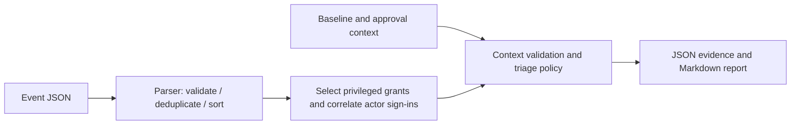

# Security Alert Triage Lab

A completed local Python demonstration that investigates fictional privileged-role
grants, correlates identity activity, checks approval context, and writes
reproducible JSON and Markdown investigation reports. It uses only the standard
library and makes no external connections or incident-response changes.

This independent portfolio project uses invented identities, documentation-range
IPs, and a normalized lab schema. It was developed incrementally with AI-assisted
mentoring. It does not connect to a company, SIEM, identity provider, or cloud API.

## Inspect the results first

| Scenario | Observations | Recommendation |
| --- | --- | --- |
| Suspicious | Three distinct failed sign-ins, then success and an Owner grant from an IP outside the actor's supplied baseline; no matching supplied approval | ELEVATED: escalate for validation |
| Approval-supported comparison | Successful sign-in from a supplied known network, a Security Admin grant, and matching prior approval | ROUTINE review, with disposition still pending |
| Failed input | A source cannot be read | FAILED execution, with no completed analysis |

Browse the [curated fictional reports](examples/README.md) without running code.
These are real outputs of this local program against synthetic inputs. Neither
ELEVATED nor ROUTINE is a confirmed incident or a declaration that access is safe.

## Quickstart

Use Python 3.11 or newer. Verified on Python 3.15.2; other versions have not been
tested. There is no pip-install step, credential setup, or server to start.

From your project folder, run:

```sh
python3 -m triage.analyze --scenario suspicious
python3 -m triage.analyze --scenario authorized
```

On the original Mac folder layout, enter the folder first with:

```sh
cd "$HOME/Documents/ChatGPT/AI Training/security-alert-triage-lab"
```

Each run prints a priority summary and the paths to `report.json` and `report.md`
inside a new `outputs/<UTC-timestamp>_<unique-run-id>/` directory. COMPLETED means
analysis finished, even if the result requires escalation or has coverage gaps.
Open Markdown for the narrative and JSON for full evidence and provenance.

To demonstrate a failed input, run this with a deliberately nonexistent filename:

```sh
python3 -m triage.analyze --events missing-demo-events.json --context data/suspicious/context.json
```

It saves FAILED reports when storage is available and exits with status 1.
Successful execution returns 0; it does not assert security. You can override
`--output-dir` and the self-declared `--analyst-label`. Custom input requires both
`--events` and `--context`; both must use the documented fictional schema.

## Architecture



`analyze.py` captures source bytes and coordinates execution. `parser.py` handles
schema checks and event provenance. `detection.py` selects grants and builds
actor-centered time windows. `context.py` returns facts, gaps, and recommendations
without file or network operations. `reporting.py` saves the output. The earlier
parser and first-rule commands remain available for learning:

```sh
python3 -m triage.parser --scenario suspicious
python3 -m triage.detection --scenario suspicious
```

Those earlier-stage commands intentionally stop before contextual prioritization
and do not save reports. Use `triage.analyze` for the complete pipeline.

## Explicit rule: triage-v1

- Scope: successful direct human-user ADDs of `roles/owner` or
  `roles/iam.securityAdmin` in `projects/demo-triage-project`. Other IAM changes
  retain IDs and reasons under skipped events; this is not exhaustive IAM analysis.
- Correlation: the granting actor's sign-ins from 30 minutes before the grant
  through grant time, inclusive. Never substitute the recipient's sign-ins.
- Elevated signal: at least three distinct same-actor/IP failures strictly before
  a successful same-IP sign-in, itself strictly before the grant, within that
  window, with the grant IP outside a complete, unambiguous supplied baseline.
- Approval: require approved status, prior approval time, matching actor,
  recipient, resource and role, and a grant within the approved half-open window.
  Preserve approval ID, approver, record index, and actual source record.
- Context gaps prevent ROUTINE handling but do not erase a positive elevated
  signal. Matching approval never suppresses the elevated signal. Known-IP failure
  chains still require review. A missing actor baseline is UNKNOWN, not known-safe.
- ROUTINE requires matching approval, known supplied IP baseline, a preceding
  successful sign-in, no failure chain, and no detected coverage gap. It is still
  a recommendation for human review, not automatic closure.

Equal timestamps cannot establish precise ordering. Matching IPs do not prove a
shared session. Fixed source dates are evaluated against source/context windows,
not the current clock. Thresholds and network baselines are demonstration choices.

## Evidence and failure handling

Every run records a unique ID, policy versions, actual UTC analysis times, source
read times, original input bytes (Base64), SHA-256 fingerprints, parsed inputs,
a deduplicated timeline, and evidence-linked cases. Original event field values
and zero-based source positions are retained. No original source file is changed.
A baseline/change-record match references the corresponding context record index.

Markdown includes the timeline, actor/recipient/role/resource, grant time, reasons,
approval details, coverage gaps, suggested actions, and a pointer into the JSON.
Untrusted display values are escaped; JSON preserves the original values.
`analystDisposition` stays PENDING and `incidentVerdict` stays UNCONFIRMED.

Normal read/validation failures retain a FAILED run and any readable source
bodies. The program checkpoints RUNNING evidence before analysis. Each output
file is written atomically, but the package is not a transactional or tamper-proof
store. Storage failures or interruption may leave partial/RUNNING artifacts.

## Tests

```sh
python3 -m unittest discover -s tests -v
```

Expected: 60 tests and OK. Coverage includes schema validation, duplicate and
conflicting IDs, timezone/interval boundaries, actor-versus-recipient correlation,
failed/removed/untracked grants, sequence order and source IP, incomplete context,
approval scope and timing, input preservation, Markdown escaping, failed-run
retention, output-write failure, and real file-to-report execution for both cases.
Tests run locally with temporary files and require no network access.

## Learn, demonstrate, and update GitHub

- [Finished-project guide](docs/FINISHED_PROJECT_GUIDE.md): run commands, output
  interpretation, code explanations, and an in-memory learning experiment.
- [Parser walkthrough](docs/PARSER_WALKTHROUGH.md): dictionaries, loops, errors,
  JSON parsing, datetime handling, and tests from the initial lesson.
- [Detection walkthrough](docs/DETECTION_WALKTHROUGH.md): grant selection and actor
  correlation from the second lesson.
- [Investigation specification](docs/SCENARIO.md): scenario design and expected facts.
- [Response playbook](docs/RESPONSE_PLAYBOOK.md): human verification, escalation,
  containment decision boundaries, and disposition considerations.
- [GitHub update guide](docs/GITHUB_UPDATE.md): replace the earlier project snapshot
  inside your existing learning repository. Nothing is uploaded automatically.

```text
triage/     Parser, correlation, context policy, coordinator, report writer
tests/      Unit, negative, boundary, and end-to-end tests
data/       Fictional event and context datasets
docs/       Learning guides, investigation specification, and response playbook
examples/   Curated synthetic reports suitable for portfolio review
outputs/    Generated local runs, ignored by Git
```

## Boundaries

This finishes the planned local lab. Real provider adapters, authenticated users,
live ingestion, queueing, independent completeness checks, production retention,
reviewer workflow, continuous monitoring, and remediation are outside this version.
The fixture schema is not a raw Google/identity-provider API format. Group,
conditional, inherited, custom-role, and impersonation paths are not analyzed.

The program trusts supplied source declarations and cannot prove approval
integrity, approver authority, baseline quality, or absence of omitted events.
It does not determine actual MFA state or effective access. Base64 is encoding,
not encryption; adjacent hashes and self-declared analyst labels do not authenticate
source or reviewer identity. A matching temporary-access ticket does not prove
expiry/removal. No claim of SOC 2 compliance or production incident readiness is made.
