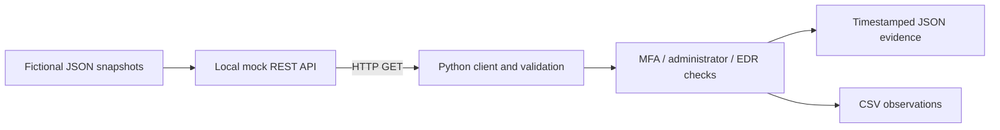

# Security Evidence Monitor

A Python portfolio project that collects fictional security observations over a
local REST API, evaluates three controls, and saves traceable JSON evidence and
CSV reports. It demonstrates recurring evidence collection for daily operations,
with two simulated daily snapshots and preserved failed-run records.

**Personal demonstration project.** No real Google Cloud, Google Workspace,
EDR vendor, or company system is connected. All identities, assets, and events are
invented. The project was developed incrementally with AI-assisted mentoring.

## Start with the results

| Control | Day 1 | Day 2 |
| --- | --- | --- |
| MFA coverage | 2 PASS, 2 FAIL | 3 PASS, 1 FAIL; Blair improves |
| New administrators | Casey's existing Owner access establishes a baseline | REVIEW: Casey grants Blair Security Admin |
| EDR coverage | VM passes; laptop has no matching agent | Laptop passes; VM's check-in is stale |

Browse the [fictional example reports](examples/README.md) without running any
software. For a live demonstration, follow the quickstart below.

## Architecture



The source client handles HTTP and JSON parsing. Control functions receive
ordinary Python dictionaries and perform no HTTP or file operations. Reporting
is separate from policy evaluation. Real read-only source adapters can replace
the mock later, subject to authorization and source-specific completeness checks.

## Quickstart

Requires Python 3.11 or newer. Verified on Python 3.15.2; other versions have not
been tested. No third-party packages, credentials, or cloud account are required.
Use the project folder as your working directory in both terminals. On the
original Mac it is:

```sh
cd "$HOME/Documents/ChatGPT/AI Training/workspace-security-monitor"
```

If you cloned the repository elsewhere, use that folder instead. An isolated
virtual environment is optional: `python3 -m venv .venv`, followed by
`source .venv/bin/activate` on macOS/Linux.

In **Terminal 1**, start the mock server and leave it running:

```sh
python3 -m monitor.mock_server
```

In **Terminal 2**, run all three controls and save each evidence package:

```sh
python3 -m monitor.collect --day 1
python3 -m monitor.collect --day 2
```

Each run prints paths to `evidence.json` and `controls.csv` under a unique
`outputs/<UTC-timestamp>_<run-id>/` folder. Open those files in an editor or
spreadsheet program. A COMPLETED run can contain FAIL, REVIEW, or UNKNOWN results.
No cloud identity or device is modified; writing local evidence is intentional.

For a failed-run demonstration, stop the server with Control+C in Terminal 1,
then run the collector again in Terminal 2. It saves a FAILED run with a reason
and NOT_EVALUATED control summaries, and exits with status 1.

The browser is optional. The only mock routes are
`http://127.0.0.1:8000/api/v1/snapshots/day-1` and
`http://127.0.0.1:8000/api/v1/snapshots/day-2`.
The root `/` returns 404. These URLs work only while the server runs on the
reader's own computer; GitHub does not host the running API.

## Policies and scope

- **MFA (`mfa-v1`):** direct human IAM users must have both Google-managed MFA
  enrollment and enforcement explicitly enabled. Missing or invalid evidence is
  UNKNOWN unless a known false value already establishes failure. Group access
  and inherited access are not expanded; conditional bindings are UNKNOWN.
- **New administrators (`new-admins-v1`):** compare direct human assignments of
  `roles/owner` and `roles/iam.securityAdmin`, then correlate normalized grant
  events for recipient, actor, resource, role, and event time. Initial access is
  BASELINE. New grants need REVIEW, not an automatic unauthorized-access verdict.
  Events can reveal grants removed between snapshots. Missing attribution and
  event coverage gaps remain visible. This is not exhaustive privilege analysis.
- **EDR (`edr-v1`):** reconcile independent device inventory with agent records.
  A required device must have one unambiguous, healthy agent with a check-in at
  most 24 hours old relative to source observation time. Missing/stale/unhealthy
  agents fail; missing or ambiguous evidence is UNKNOWN. Explicit exclusions and
  orphan EDR devices are disclosed. No actual EDR agents are installed.

These are technical demonstration policies, not universal SOC 2 requirements.
They support an evidence strategy without asserting SOC 2 compliance.

## Evidence: who, what, and when

Each package retains a unique run ID, self-declared collector label, actual UTC
collection times, source request metadata, response bodies and body fingerprints,
parsed validated snapshots, policy versions, observations, reasons, exclusions,
and coverage gaps. Administrator actor and event time are retained when supplied
by an event; missing attribution stays unknown. Source/event timestamps remain
separate from collection timestamps.

The CSV includes control summaries and observations, with pointers into the JSON
for traceability. It also preserves gaps and exclusions. Formula-like CSV values
are neutralized; original values remain in JSON. Collection failures are recorded
rather than represented as passing controls. See [the evidence guide](docs/EVIDENCE.md).

## Tests

```sh
python3 -m unittest discover -s tests -v
```

69 tests cover real localhost HTTP retrieval, rejected writes, response/schema
validation, control decisions, time boundaries, missing sources, event attribution,
failed-run retention, JSON/CSV consistency, and safe CSV handling. Tests create
and close their own temporary servers; no manual server is required. The process
must be allowed to bind loopback sockets. No external service is used.

## Project layout

```text
monitor/    HTTP server, source client, three checks, collector, reporting
tests/      Standard-library unit and integration tests
data/       Fictional source snapshots and the original user-learning fixture
examples/   Curated fictional JSON evidence and CSV reports
docs/       Evidence guide, GitHub/demo walkthrough, incremental learning notes
outputs/    Local generated runs; ignored by Git
```

Individual lessons remain runnable with `python3 -m monitor.client --day 1`,
`python3 -m monitor.check_mfa --day 1`, `python3 -m monitor.check_admins --day 2`,
and `python3 -m monitor.check_edr --day 1`. These print results without saving
files; use `monitor.collect` for saved evidence. Earlier beginner exercises are
preserved in [the learning notes](docs/LESSONS.md).

## Limits and next work

The mock declares source completeness; a real collector must establish it using
pagination, independent inventories, scope reconciliation, and source-specific
freshness checks. This project does not prove whole-organization coverage.
Fixed scenario dates can be earlier or later than actual collection time.

Local files and adjacent SHA-256 fingerprints are not authenticated or tamper-
evident evidence. Collector identity is a label, not verified authentication.
File writes are individually atomic; disk failures or interruption can still
leave incomplete runs. Production retention, access controls, signing, durable
baseline management, review dispositions, real integrations, and scheduling
remain future work. Simulated daily snapshots are not an active daily schedule.

To present or publish the project, use [the GitHub and demo guide](docs/GITHUB.md).
Nothing has been uploaded, no Git repository has been initialized, and no license
has been selected for reuse yet.
